# Sizing

Three ways a chart fits its box: scaled by CSS, drawn again at the box's
width (`hx-plot:autosize`), and drawn again at its width and height
(`hx-plot:autosize="both"`).

| Drawn for a 320 px box | Drawn for a 720 px box |
|---|---|
|  |  |

The narrow one has fewer ticks and the same 12 px text, rather than the
wide one shrunk to fit.

## Run

```sh
go run ./examples/recipes/sizing            # http://localhost:8080
go run ./examples/recipes/sizing -addr :9000
```

## What to look at

1. Each chart's title says the size the server drew. The first stays at
   640 × 320 and its text shrinks with the box; the other two match their
   boxes.
2. Resize the window. In devtools' Network panel, each resize of 8 px or
   more (debounced) sends `GET /charts/width?hp-w=…` and
   `GET /charts/both?hp-w=…&hp-h=…`.
3. The middle chart keeps its 240 px height whatever the box: it sends no
   `hp-h`, because a box as tall as its content would feed the chart's own
   height back and grow it on every request.
4. The right-hand box has a CSS height (300 px, `overflow: hidden`), so
   `hx-plot:autosize="both"` is safe and the chart fills it exactly.
5. Request `/charts/width?hp-w=99999` or `?hp-w=abc` yourself: the server
   clamps to 4096 or falls back to 640, and never errors.

## Key code

| What | Where |
|---|---|
| `hx-plot:autosize` on the box that holds the chart | `page.html` |
| `hx-trigger="load, htmx:plot:resize"` | `page.html` |
| `hx-swap="innerMorph"` with a stable `Chart.ID` | `page.html`; `main.go`: `chart` |
| `width, _ := hx.Size(r, defaultWidth, 0)` | `main.go`: `width` |
| `width, height := hx.Size(r, defaultWidth, defaultHeight)` | `main.go`: `both` |
| `.box-tall { height: 300px; overflow: hidden }` | `app.css` |
| A render error answers htmx with 204, which keeps the last chart | `main.go`: `fragment` |

## How it works

The extension watches every `hx-plot:autosize` element with a
`ResizeObserver`, fires `htmx:plot:resize` on it when its width changes,
and adds `hp-w` (its content width) to every htmx request that targets it,
plus `hp-h` for `both`
([spec §6.7](../../../docs/spec.md#67-request-parameters)). The server
accepts the parameters on every chart URL, clamps them to [50, 4096] and
uses its default for anything else
([§4.6](../../../docs/spec.md#46-size-parameters)); `hx.Size` does that in
one call. The page itself renders every chart at the default size, so it
shows without script; `load` then fetches each one at the real size. See
[Responsive charts with autosize](../../../docs/htmx.md#responsive-charts-with-autosize)
and [Height](../../../docs/htmx.md#height) in the htmx guide.

This page loads htmx 4.0.2 and `hx-plot.js` and nothing else: no polling
tags and no SSE. With polling, a resize always swaps (the size is part of
the SVG), and polls at a steady size still get `304`.

## Tests

```sh
go test ./examples/recipes/sizing
go test ./examples/recipes/sizing -update   # rewrite preview/
make golden   # every golden file and preview, after a renderer change
```

They check the page (status, CSP header, the pinned htmx tag with its
integrity hash, the autosize attributes, well-formed charts, no `style` or
`on*` attributes), a table of `hp-w` and `hp-h` cases including clamped and
invalid values, that the chart id is the same at every size, the assets,
and that the previews are current.
