# Sparkline table

A KPI table with a sparkline in each row: one service per row, its traffic
and latency over the last 30 minutes, and no JavaScript at all.



## Run

```sh
go run ./examples/recipes/sparkline-table            # http://localhost:8080
go run ./examples/recipes/sparkline-table -addr :9000
```

## What to look at

1. Each row's two sparklines are plain inline `<svg class="hp-spark">`
   elements, sized like an icon (120 × 28) and colored by the stylesheet.
2. Inspect one in devtools: `role="img"` and an `aria-label` such as
   "checkout requests per second, last 30 minutes: first 774 req/s, min
   774 req/s, max 1,370 req/s, last 937 req/s". A screen reader hears the
   trend; the visible "Now" column holds the figure everyone reads.
3. Switch the system to dark mode: the sparklines switch palette with the
   page, because the stylesheet declares its tokens on `.hp-spark` too.
4. Narrow the window: the table scrolls inside its own focusable region
   instead of squeezing the sparklines.
5. The Network panel shows no script. A sparkline is not a chart
   (no tooltip, no ids), so the hx-plot extension would ignore it anyway.

## Key code

| What | Where |
|---|---|
| `hyperplot.Sparkline{Values, Label, Unit, Area}.HTML()` | `main.go`: `buildRows` |
| `Label` and `Unit` make the accessible name | `main.go`: `buildRows` |
| `<th scope="row">`, `<caption>`, the scrolling region | `page.html` |
| `.spark .hp-spark { display: block }` drops the baseline gap | `app.css` |
| `hyperplot.Stylesheet()` colors the sparklines; nothing else is loaded | `main.go`: `routes` |
| `scale.FormatNumber` for the figures, with thousands separators | `main.go`: `buildRows` |

## How it works

A sparkline renders a 2 px line, an optional area wash and a dot on the
last value, with no axes, title, tooltip or ids, so it repeats freely on a
page (see [Sparkline](../../../docs/DESIGN.md#sparkline) in the design). Its
root class is `hp-spark`, not `hp`: the extension and the wire spec treat
every `svg.hp` as a chart ([spec §6.4](../../../docs/spec.md#64-finding-charts)),
and a sparkline does not meet a chart's contract. Inside, it uses the chart
classes (`hp-s1`, `hp-line`, `hp-area`, `hp-end`), so one stylesheet, and
its dark mode ([Dark mode](../../../docs/htmx.md#dark-mode)), covers both.

The change column uses an arrow and a sign, not a color: more traffic is
neither good nor bad. To keep the rows live, poll the `<tbody>` with
`hx-get`, `hx-trigger="every 30s"` and `hx-swap="innerMorph"`, the way the
[builds demo](../../builds/README.md) polls its charts
([Pattern 1](../../../docs/htmx.md#pattern-1-polling-with-content-tags)).

## Tests

```sh
go test ./examples/recipes/sparkline-table
go test ./examples/recipes/sparkline-table -update   # rewrite preview/sparklines.svg
make golden   # every golden file and preview, after a renderer change
```

They check the page (status, CSP header, ten well-formed sparklines, the
accessible names, one row per service, no `style` or `on*` attributes, no
script), the direction of each change, that the data depends only on the
minute, and that the preview is current. The preview puts the traffic
sparklines and the stylesheet into one SVG file, since a sparkline has no
standalone mode of its own.
