# Standalone SVG

Charts written as self-contained `.svg` files, for a README, a report, a
slide or an `` tag: anywhere without the page's stylesheet or script.

| `latency.svg` (follows the reader's light or dark setting) | `latency-dark.svg` (always dark) |
|---|---|
|  |  |

## Run

```sh
go run ./examples/recipes/standalone-svg                           # writes to a temp directory
go run ./examples/recipes/standalone-svg -out ../hyperplot-charts  # or to a directory you pick
```

Run it from the repository root and pick an `-out` directory outside the
repository, so the generated files don't show up in `git status`.
`../hyperplot-charts` means the same in every shell; `~` does not (Windows
PowerShell and cmd.exe pass it to the program as a literal `~` directory
name). Without `-out` it writes to `hyperplot-standalone` in the system's
temporary directory, the same directory on every run.

It writes `latency.svg`, `latency-dark.svg`, `deploys.svg` and an
`index.html` that shows them with `` tags (plus `index.css`, which
lets the images shrink on a phone), and prints where. Open `index.html`
in a browser, or open an `.svg` file directly.

## What to look at

1. Open `latency.svg` in a text editor: one `<svg>` with a `<style>`
   element (the theme's stylesheet), a background `<rect>`, the visible
   title, and the same structure as an inline chart.
2. Switch your system between light and dark and reload `index.html`:
   `latency.svg` and `deploys.svg` follow (the embedded stylesheet's
   `prefers-color-scheme` query); `latency-dark.svg` stays dark.
3. Hover a bar in `deploys.svg`: a native tooltip from its `<title>`. Lines
   have none, and nothing responds to the keyboard: a file has no
   `hx-plot.js`.
4. Run the command twice: the files are byte-identical, so committing them
   gives clean diffs.
5. In `index.html`, each `` has `alt` text. An `` hides the
   SVG's own `<title>` and `<desc>` from screen readers.

## Key code

| What | Where |
|---|---|
| `Chart.Standalone = true`, then `Chart.Render()` | `main.go`: `write` |
| `Chart.Theme`: a `Theme` whose light and dark palettes are both dark | `main.go`: `write`, `latencyChart` |
| Fixed data, no clock: same input, same bytes | `main.go`: `latencyChart`, `deploysChart` |
| `` | `main.go`: `index` |

## How it works

A chart is well-formed XML by contract
([spec §3.1](../../../spec/spec.md#31-embedding)), so the same bytes work
inline in HTML and as a file. `Standalone` adds what a file lacks: the
stylesheet (`Theme.CSS()`, see
[CSS](../../../docs/DESIGN.md#css-themecss) in the design), a background
in the theme's surface color, a margin and the title. Shown on its own or
through ``, a chart gets only the native fallback
([§3.7](../../../spec/spec.md#37-native-fallback)).

Two places to use it with care:

- **Pages.** Don't inline a standalone chart in a page: its `<style>`
  element needs `style-src 'unsafe-inline'` under a Content Security
  Policy. Inline the normal output with the stylesheet instead
  ([Content Security Policy](../../../docs/htmx.md#content-security-policy)).
  An `` of the file is fine.
- **Email.** Support for SVG varies a lot between mail clients, and several
  widely used ones don't show it at all. For email, send a PNG made from
  the file (a headless browser can screenshot it) or link to the file.

To serve a chart as a download or an export, write the same bytes with
`Content-Type: image/svg+xml`.

## Tests

```sh
go test ./examples/recipes/standalone-svg
go test ./examples/recipes/standalone-svg -update   # rewrite preview/
make golden   # every golden file and preview, after a renderer change
```

They write the files into a temporary directory and parse each one with
`encoding/xml` (namespace, `class="hp"`, `data-hp`, `<title>` matching the
`alt` text, the embedded stylesheet, the size, no `style` or `on*`
attributes, no CR). They also check that the dark file uses the dark
palette, that `index.html` lets its images shrink without inline styles,
that two runs give identical bytes, and that `preview/` is current.
