# Static page

Charts rendered once by the server on a page with no htmx at all:
`hx-plot.js` alone adds tooltips, a crosshair and keyboard reading.



## Run

```sh
go run ./examples/recipes/static-page            # http://localhost:8080
go run ./examples/recipes/static-page -addr :9000
```

## What to look at

1. Hover the latency chart: a crosshair and a tooltip with both series at
   that minute. Hover the bars: a band highlight.
2. Press Tab until a chart is focused, then ArrowLeft, ArrowRight, Home and
   End. A screen reader hears each step through the status region the
   extension adds (`div.hp-live`, at the end of `<body>` in devtools'
   Elements panel).
3. Open **View as table** under a chart: the same numbers as the tooltips,
   for screen readers and anyone who wants them exact.
4. In devtools' Network panel, nothing happens after the page has loaded.
   View the page source: there is no htmx and no `hx-*` attribute, only
   `<script defer src="/static/hx-plot.js">`.
5. Turn JavaScript off (devtools: Ctrl+Shift+P, "Disable JavaScript") and
   reload. The charts still show; each bar keeps a native `<title>`
   tooltip, and the tables still work.

## Key code

| What | Where |
|---|---|
| `Chart.HTML()` puts the chart in the page, escaped | `main.go`: `page` |
| `Chart.Table()` beside it in `<details>` | `main.go`: `page`, `page.html` |
| `<script defer src="/static/hx-plot.js">`, no htmx | `page.html` |
| `client.Handler()` serves the script, `plot.Stylesheet()` the CSS | `main.go`: `routes` |
| An explicit, stable `Chart.ID` | `main.go`: `latencyChart`, `regionsChart` |
| Data as a function of the minute, so a reload within a minute is identical | `main.go`: `latencyChart`, `noise` |

## How it works

When `hx-plot.js` runs and finds no htmx, it starts in standalone mode
([spec §6.10](../../../spec/spec.md#610-without-htmx)): every inline chart
gets the pointer and keyboard behaviour of
[§6.5](../../../spec/spec.md#65-pointer-and-keyboard-level-1), read from the
JSON in the chart's `<metadata class="hp-tips">`. There are no swaps, so
nothing else applies. Without script at all, the chart falls back to native
titles ([§3.7](../../../spec/spec.md#37-native-fallback)) and the table
([§3.8](../../../spec/spec.md#38-the-table-equivalent)). See
[Tooltips, keyboard reading and tables](../../../docs/htmx.md#tooltips-keyboard-reading-and-tables)
in the htmx guide.

Adding htmx later changes nothing on this page: the same charts become live
once a container polls or streams them. See
[Pattern 1](../../../docs/htmx.md#pattern-1-polling-with-content-tags) and
[Pattern 2](../../../docs/htmx.md#pattern-2-server-sent-events) in the htmx
guide; the [builds demo](../../builds/README.md) polls its charts and the
[sensors demo](../../sensors/README.md) streams its tiles.

## Tests

```sh
go test ./examples/recipes/static-page
go test ./examples/recipes/static-page -update   # rewrite preview/latency.svg
make golden   # every golden file and preview, after a renderer change
```

They check the page (status, CSP header, every `<svg>` well-formed XML, no
`style` or `on*` attributes, no repeated ids, no htmx), the scripts and
stylesheets, that the data depends only on the minute, and that the
preview is current.
