# Theming

The same charts in two palettes, each light and dark: the default theme
and a custom one built from it with `Theme.CSS()`, switched with plain
links.

| Brand palette, light | Brand palette, dark |
|---|---|
|  |  |

## Run

```sh
go run ./examples/recipes/theming            # http://localhost:8080
go run ./examples/recipes/theming -addr :9000
```

## What to look at

1. Click **Dark**, **Light** and **System**. The server writes
   `<html data-theme="dark">` (or nothing, for System); the charts' markup
   doesn't change, only the CSS custom properties they read.
2. Click **Brand**: the page loads `/static/brand.css` instead of
   `/static/hx-plot.css`. Slot 1 is now the page's own `--brand` color
   (the links use it too); the surface and ink are warmer; slots 2 to 8 are
   unchanged.
3. The two charts use all eight series colors: lines in slots 1 to 4, bars
   pinned to slots 5 to 8 with `Slot`.
4. Hover a chart: the tooltip uses the same palette (`.hp-tip` reads the
   same tokens).
5. Emulate a contrast theme: devtools, Ctrl+Shift+P, "Show Rendering",
   then "Emulate CSS media feature forced-colors: active". Text, grid and
   frame take the system colors; the series keep their colors so they stay
   apart.
6. Try `/?theme=nonsense&palette=../x`: unknown values fall back to the
   defaults and are never written into the page.

## Key code

| What | Where |
|---|---|
| `plot.DefaultTheme()`, change some tokens | `main.go`: `brandTheme` |
| A palette value of `var(--brand, #0b6bcb)` | `main.go`: `brandTheme`; `--brand` in `app.css` |
| `Theme.CSS()` served as a stylesheet | `main.go`: `routes` |
| `<html data-theme="…">` from `?theme=` | `main.go`: `page`; `page.html` |
| `Slot: 5 + i` pins the bars' colors | `main.go`: `clientsChart` |
| The page's own colors follow `data-theme` too | `app.css` |

## How it works

Charts carry classes, never colors: each series is `hp-s1` … `hp-s8` and
marks use `currentColor`, so the stylesheet decides every color through the
`--hp-*` custom properties ([spec §3.4](../../../spec/spec.md#34-presentation)).
`Theme.CSS()` writes those properties for a light and a dark palette, the
switch on `prefers-color-scheme` and `data-theme`, and the forced-colors
rules ([CSS](../../../docs/DESIGN.md#css-themecss) in the design;
[Dark mode](../../../docs/htmx.md#dark-mode) in the htmx guide).

Keep the series order when you make your own palette: it is what keeps
adjacent series distinguishable for readers with color-vision deficiencies
([the default tokens](../../../docs/DESIGN.md#default-theme-tokens-validated-palette)).
Changing the surface, the ink and one brand slot, as here, is the safe
kind of change. `Theme.CSS` replaces any value that isn't shaped like a
color with the default, so even a palette from user input cannot inject
CSS.

A standalone file (`Chart.Standalone`, see
`examples/recipes/standalone-svg`) embeds the same CSS, which is how the
pictures above were made. There, `var(--brand, …)` has no page to read
from and uses its fallback.

## Tests

```sh
go test ./examples/recipes/theming
go test ./examples/recipes/theming -update   # rewrite preview/
make golden   # every golden file and preview, after a renderer change
```

They check each combination of the links (the `data-theme` attribute, the
stylesheet, which links are current, that untrusted values are dropped),
the CSP header, well-formed charts with no `style` or `on*` attributes,
all eight slots on the page, the brand stylesheet's tokens and rules, and
that the previews are current.
